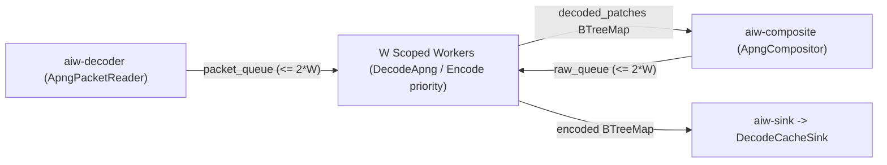

# ADR-003: Bounded Parallel APNG Decompression and Ordered Compositing Pipeline

## Status

Accepted

## Date

2026-11-16

## Context

After parallelizing `Lanczos3` downscaling, premultiplication, and LZ4 compression across worker threads (commit `7168243`) and flushing startup frames ahead of steady batching (commit `448ee63`), cold-cache `--stats` profiling on `M_Animation_120fps.apng` (`720` frames) still measured `15.90s` total decode time (`45.3 frames/s`), causing `55` to `84` decode-frontier holds per second during the initial playback loop.

Profiling showed `aiw-decoder` spent most of that window running `image::codecs::png::ApngDecoder` PNG zlib decompression, scanline unfiltering, and canvas blending sequentially on a single thread. Because later APNG frames depend chronologically on `DisposeOp` and `BlendOp` state from earlier frames, full-frame compositing must stay strictly ordered, yet inflating each frame's `IDAT` / `fdAT` compressed chunks into straight-RGBA patches is completely independent across frames.

## Decision

Split APNG decoding into sequential chunk extraction, parallel per-frame PNG inflation, ordered canvas compositing, parallel frame encoding, and ordered early-flush sink delivery within one bounded scoped worker pool.

### 1. Single-Open Chunk Splitter and Standalone Patch Inflation (`src/decode/apng/reader.rs`, `src/decode/apng/patch.rs`, `src/decode/codecs.rs`)

- Probe PNG files once through `ApngPacketReader::try_open`, returning static PNGs cleanly rewound to byte offset `0` (`OpenedSource::StaticPng`) without reopening the file descriptor.
- Extract sequential `RawApngPacket` slices (`fcTL` + consecutive `IDAT` or prefix-stripped `fdAT` payloads), skipping any hidden static `IDAT` fallback thumbnail when `fcTL` precedes `IDAT`.
- Have parallel pool workers run `decode_apng_packet` by framing each packet into a lightweight single-frame PNG (carrying shared `IHDR` tail bytes plus palette/color ancillary chunks such as `PLTE`, `tRNS`, `gAMA`, `cHRM`, `sRGB`, `iCCP`, and `cICP`) and inflating straight-RGBA patches via `PngDecoder::new`.

### 2. Spec-Ordered APNG Canvas Compositor (`src/decode/apng/compositor.rs`)

- Run `ApngCompositor` sequentially across inflated patches in frame order `0..N`, backing up `saved_previous_patch` only when a frame declares `DisposeOp::Previous`.
- Execute the outgoing frame's disposal rule (`DisposeOp::Background` clear or `DisposeOp::Previous` restore) *before* snapshotting `saved_previous_patch` for an incoming `DisposeOp::Previous` frame, matching W3C APNG Third Edition semantics (unlike `image-0.25.10`'s `ApngDecoder::mix_next_frame`, which snapshots `previous` before running `Background` clear).

### 3. Shared Worker Pool with Encode Priority and Dual Bounded Queues (`src/decode/pipeline/`, `src/decode/stream.rs`, `src/cache/sink.rs`)

- Decode Frame `0` synchronously (`decode_apng_first_frame` + `encode_first_frame`) before displaying the overlay window, checking early `cancel` before launching worker threads.
- Reuse `(available_parallelism - 2).clamp(1, 6)` scoped threads (`RESERVED_PIPELINE_THREADS = 2`, `MAX_ENCODE_WORKERS = 6`) for both APNG packet inflation (`WorkerJob::DecodeApng`) and RGBA scaling/LZ4 compression (`WorkerJob::Encode`), while GIF and WebP animations feed sequential container frames into the same `WorkerJob::Encode` pool via `stream_remaining_frames`.
- Bound `packets_in_flight` and `in_flight` independently at `2 * workers` (`12` max on 16-thread CPUs) and strictly dequeue `raw_queue` (`WorkerJob::Encode`) ahead of `packet_queue` (`WorkerJob::DecodeApng`) inside `pop_worker_job`. Draining full-canvas RGBA frames first prevents workers from starving `push_raw` backpressure while compressed packets keep inflating.
- Flush startup frames individually inside `DecodeCacheSink::on_frame` (`EARLY_WAKEUP_FRAMES = 8`) before switching to steady `DECODE_BATCH_SIZE = 4` batching so initial playback advances without waiting behind the first 4-frame batch.

## Alternatives Considered

- **Separate `rayon` thread pools or fixed decode vs encode worker pools:** Rejected to preserve zero new `Cargo.toml` dependencies, avoid CPU oversubscription alongside Wayland compositor threads, and prevent idle encode threads while decode saturates or vice versa.
- **Custom raw `flate2` + PNG unfiltering/palette expansion:** Rejected because synthesizing compact single-frame PNG buffers delegates filtering, bit-depth unpacking (`1..8` bit), indexed `PLTE`/`tRNS`, and interlacing to `PngDecoder` cleanly under `unsafe_code = "forbid"`.
- **Reopening or cloning `image::codecs::png::ApngDecoder` across frames:** Rejected because `ApngDecoder` couples chunk reading with stateful canvas blending and cannot share work across threads.
- **Uncapped worker count above `6`:** Capped at `6` so `2 * workers` queued full-canvas buffers keep transient decode heap growth bounded and reserve CPU cores for Wayland UI and compositor presentation.

## Consequences

- Parallelizes per-frame PNG zlib inflation and scanline decoding across up to `6` workers while preserving strict compositing order without adding extra codec or thread-pool dependencies (`std::thread` and existing `PngDecoder` only).
- Enforces W3C `DisposeOp::Background -> DisposeOp::Previous` conformance verified by synthetic APNG parity and spec tests alongside mid-stream cancellation, sink error, and corrupt `fdAT` worker-failure tests (`tests/apng_tests.rs`).
- Keeps GIF and animated WebP codecs on sequential container reads feeding the same bounded parallel `Lanczos3`/LZ4 stage without duplicating pipeline orchestration.
