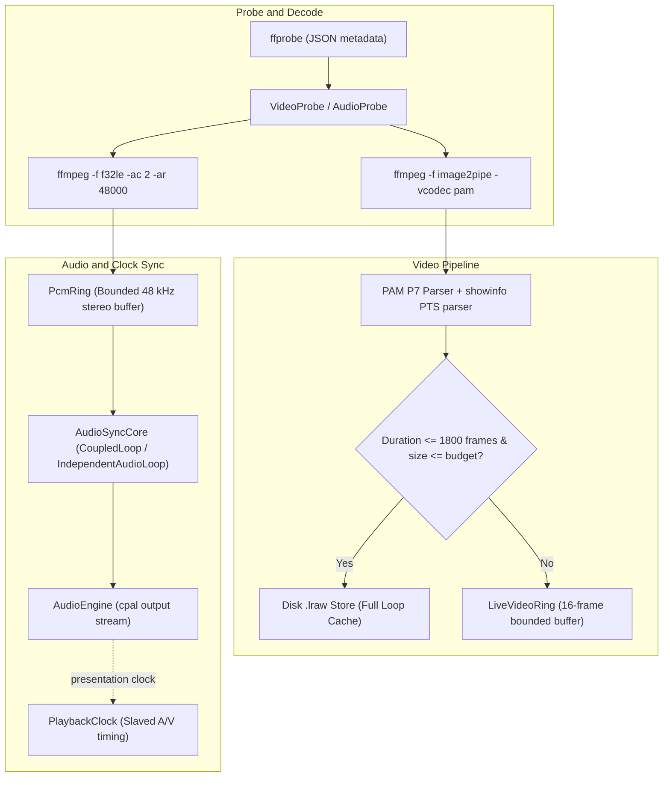

# ADR-004: MP4 Video Decoding, Lookahead Streaming, and Synchronized Audio Subsystem

## Status

Accepted

## Date

2026-11-16

## Context

Users requested native playback of video containers (`MP4`, `MOV`, `WebM`, `MKV`, `AVI`) alongside existing animated image formats (`APNG`, `GIF`, `WebP`), as well as pairing external companion audio tracks (`--audio <FILE>`) with both video and image overlays.

Direct video playback introduces several challenges:
1. Video decoders and demuxers in C/C++ (such as `libavcodec`) require extensive unsafe bindings and introduce system package version drift, conflicting with `#![forbid(unsafe_code)]`.
2. Videos range from short animated stickers to multi-minute clips. Unconditionally caching all frames to disk as `.lraw` LZ4 chunks would exhaust disk space, whereas decoding directly to a single frame buffer without lookahead causes compositor stutter.
3. Synchronizing video frames with audio across variable display refresh rates requires precise clock tracking, loop point synchronization, and click-free volume adjustment.

## Decision

Implement an external subprocess pipeline for video and audio decoding, a hybrid caching and streaming engine, and an in-process `cpal` audio playback system with sample-accurate clock tracking.

### 1. Subprocess Demuxing and Decoding (`src/decode/video/`, `src/audio/`)

- Run `ffprobe` as an external subprocess with `-v error -show_entries ... -of json` to extract container geometry, frame count, microsecond duration, frame rate, stream rotation tags, and audio stream presence.
- Stream video frames from `ffmpeg` via stdout formatted as raw PAM (`Portable Arbitrary Map`, `P7`) straight RGBA, extracting microsecond presentation timestamps from `showinfo` filter stderr logs.
- Stream audio from `ffmpeg` via stdout as raw 48 kHz stereo interleaved 32-bit floating point PCM (`f32le`), avoiding external audio codec dependencies.
- This subprocess boundary preserves `#![forbid(unsafe_code)]` across the entire crate and eliminates version coupling with system FFmpeg shared libraries.

### 2. Dual-Mode Video Storage: Hybrid Disk Cache and Lookahead Ring (`src/cache/`)

- Short video loops (`<= 1800` frames and total uncompressed bytes `<= video_cache_budget_bytes`, configured by `-c video=<MB>`, defaulting to 512 MiB) decode into deterministic `.lraw` LZ4 disk chunks and `.json` metadata sidecars, matching animated image cache behavior.
- Long videos, or short videos when `-c video=0` is set, bypass disk writing and stream through `LiveVideoRing`.
- `LiveVideoRing` maintains a bounded 16-frame circular buffer (`LIVE_RING_CAPACITY = 16`) filled by a background reader thread and consumed by the Wayland event loop. When the buffer drops below the low-water mark (`LIVE_RING_LOW_WATER = 4`), the reader thread decodes lookahead frames. When the video reaches the final frame, the reader re-executes `open_video_frames` to restart the stream seamlessly.

### 3. In-Process Audio Playback and Clock Synchronization (`src/audio/`, `src/wayland/runtime/`)

- Audio playback runs in-process via `cpal 0.18` on the ALSA/PipeWire backend to ensure minimal output latency and continuous sample-level timeline monitoring.
- `PcmRing` buffers decoded audio frames between the FFmpeg audio reader thread and the real-time audio callback.
- `AudioSyncCore` provides smooth linear slew ramping (`SLEW_RAMP_SAMPLES = 256`) during volume and mute changes, preventing audio pops or clicks.
- For video files with embedded audio, `AudioSyncCore` operates in `CoupledLoop` mode. The video presentation clock queries `audio_engine.current_position()` to align video frame presentation with the audio playback clock. If the video loops, the audio loop wrap triggers frame reset.
- For companion audio tracks paired with static images or animated images (`APNG`, `GIF`, `WebP`), `AudioSyncCore` operates in `IndependentAudioLoop` mode, allowing audio to loop continuously on its own timeline.

### 4. Interactive Volume Controls and Preferences (`src/wayland/`, `src/config.rs`)

- Add edit-mode keyboard shortcuts: `m` toggles mute, `,` decreases volume by 5%, and `.` increases volume by 5%.
- Save audio volume and mute state in `$XDG_CONFIG_HOME/apng-overlay.json` under an `audio` object (`AudioPrefs { volume, muted }`) associated with the image path.

## Alternatives Considered

- **In-tree bindings to `libavcodec` / `libavformat` (`ffmpeg-next`):** Rejected because dynamic C library linkage requires unsafe code, introduces build failures across diverse Linux distributions, and complicates compilation.
- **In-process pure-Rust audio decoding (e.g. `symphonia`):** Rejected in favor of piping 48 kHz stereo PCM from `ffmpeg` subprocess, which supports all audio formats, containers, and sample rate conversions uniformly.
- **Unconditionally caching all video frames to disk:** Rejected because long videos (such as full songs or multi-minute animations) would write tens of gigabytes to disk, causing disk exhaustion and high cold startup latency.

## Consequences

- Fully supports `MP4`, `MOV`, `WebM`, `MKV`, and `AVI` video containers without adding unsafe code or direct C library dependencies.
- Bounded memory and disk consumption regardless of video length through `LiveVideoRing` streaming and configurable `-c video=<MB>` disk caching.
- Monotonic, click-free audio output and synchronized video frame scheduling via `cpal` and `AudioSyncCore`.
- Preserves full backward compatibility with existing image formats, configuration files, and caching infrastructure.
